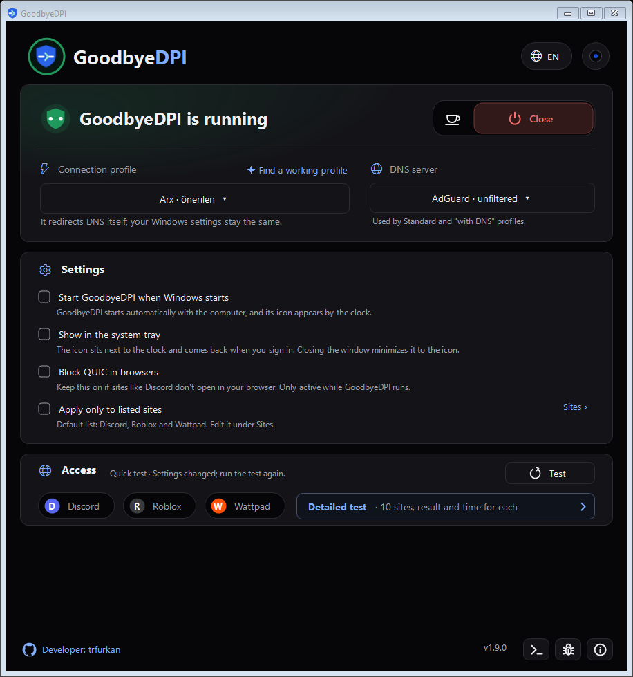

[Türkçe](README.md) · [English](README.en.md)

# GoodbyeDPI Tray

**A Windows interface and service manager for GoodbyeDPI.**

[](https://github.com/trfurkan/GoodbyeDPI-Tray/releases/latest)
[](https://github.com/trfurkan/GoodbyeDPI-Tray/releases)
[](LICENSE)


GoodbyeDPI Tray brings the [GoodbyeDPI](https://github.com/ValdikSS/GoodbyeDPI) engine and [GoodbyeDPI-Turkey](https://github.com/cagritaskn/GoodbyeDPI-Turkey) profiles into one window. It combines connection controls, DNS selection, a site list and access tests for everyday use.

**[Download the latest version](https://github.com/trfurkan/GoodbyeDPI-Tray/releases/latest)** · [Website](https://trfurkan.github.io/GoodbyeDPI-Tray/en/) · [User guide (Turkish)](docs/KULLANIM.md) · [Release notes](https://github.com/trfurkan/GoodbyeDPI-Tray/releases)



> [!NOTE]
> This is not a VPN. It does not change your IP address or provide VPN privacy features. Results depend on your provider, the blocking method and the selected profile; it is not guaranteed to work on every network.

## Installation and first use

**Requirements:** Windows 10 or 11 (x86/x64), .NET Framework 4.8.

1. Download `GoodbyeDPI-Installer-<version>.exe` from the [latest release](https://github.com/trfurkan/GoodbyeDPI-Tray/releases/latest).
2. Open the installer, read the installation notice and click **Install**. Approve the Windows administrator permission prompt.
3. Open the app and start with the recommended **Arx** profile.
4. Run the **Access test**. If it cannot connect, use **Find a suitable profile** to compare alternatives.

Windows and browsers may warn about unsigned or uncommon downloads. Read the warning and check that the file came from this repository’s Releases page. A warning alone does not establish that a file is safe or harmful.

If an existing GoodbyeDPI service is found, the installer asks before taking it over. To uninstall, use the app’s uninstall option or **Windows Settings → Apps**.

## Features

| Feature | What it provides |
| --- | --- |
| **Connection controls** | Start, stop and timed pauses from the main window or system tray. |
| **Profile selection** | Arx, Nyx, Kitsune and Raijin options; comparison of seven GoodbyeDPI profiles. |
| **DNS selection** | AdGuard, Quad9, OpenDNS, CleanBrowsing and Yandex. Unfiltered AdGuard is the default. |
| **Ad filtering** | AdGuard’s ad-filtering DNS option. It requires a profile that uses DNS and does not block every ad. |
| **Site list** | Built-in Discord, Roblox and Wattpad domains, custom addresses and processing limited to listed sites. |
| **Access tests** | Quick and detailed connection checks with response times. |
| **Console and issue reports** | Engine output and a GitHub issue draft you can edit before submitting. |
| **Appearance and startup** | Themes, Turkish/English/Russian interfaces and automatic startup with Windows. |

DNS selection applies only to profiles that redirect DNS. The site list selects **domains**, not applications by name. DNS and QUIC blocking settings are not restricted to the site list.

## How it works

GoodbyeDPI changes how connection data is transmitted to help bypass some restrictions based on traffic inspection. GoodbyeDPI is the engine that attempts to bypass restrictions; Tray simplifies its installation and everyday use.

- **Windows service:** The `GoodbyeDPI` service runs as SYSTEM and manages the engine process.
- **Desktop interface:** Runs with normal user privileges and sends start, stop and configuration requests to the service.
- **Connection:** Traffic is not routed through a VPN server. Some restrictions, such as direct IP blocks, cannot be bypassed.
- **Updates:** New release information is retrieved from GitHub. Checking for updates and installing them are separate operations.

This is an independent project, not an official distribution of GoodbyeDPI or GoodbyeDPI-Turkey.

## Troubleshooting

If a site does not open, stop the app and compare the connection. Then run an access test and, if needed, try another profile or DNS option. A failed test alone does not prove blocking; the site, DNS or a timeout may be responsible.

With list mode enabled, check that the relevant domain is included. If the problem persists, [open a bug report](https://github.com/trfurkan/GoodbyeDPI-Tray/issues/new) with:

- Your application and Windows versions.
- Selected profile, DNS and relevant connection settings.
- Steps to reproduce the problem and the expected result.
- Relevant log excerpts or screenshots, with personal information removed before sharing.

Application log: `%LOCALAPPDATA%\GoodbyeDPI Tray\Logs\application.log`. See the [user guide (Turkish)](docs/KULLANIM.md) for more details.

## Development

The project uses C#, WinForms and .NET Framework 4.8. The build script calls the .NET Framework compiler (`csc.exe`); Visual Studio is not required. Run these commands on Windows from the repository root:

```powershell
powershell -NoProfile -ExecutionPolicy Bypass -File scripts\build.ps1
```

| Output | Contents |
| --- | --- |
| `build\app\GoodbyeDPI.Tray.exe` | Interface, service and uninstaller |
| `dist\GoodbyeDPI-Installer.exe` | Installer |

After building, run the basic verification:

```powershell
powershell -NoProfile -ExecutionPolicy Bypass -File tests\verify.ps1
```

Other test scripts are in `tests/`. Scripts in `tests/system/` modify the actual installation and Windows service; run them only in a dedicated test environment.

```text
src/                 Application, service, setup and interface code
assets/              Application icons and visual resources
scripts/             Build and packaging scripts
tests/               Verification and behavior tests
vendor/goodbyedpi/    Engine, drivers and third-party licenses
docs/                Website, user guide and release notes
```

## Contributing

Bug reports, feedback and pull requests are welcome. For a substantial change, [open an issue](https://github.com/trfurkan/GoodbyeDPI-Tray/issues) first to discuss your approach. Describe the purpose of your change and the checks you performed in your pull request.

Developed by [Furkan](https://github.com/trfurkan). If the project is useful to you, a GitHub star is a welcome way to support it.

## License and upstream projects

The application code is released under the [Apache License 2.0](LICENSE). Third-party components have separate licenses; see [THIRD_PARTY_NOTICES.md](THIRD_PARTY_NOTICES.md).

- [GoodbyeDPI](https://github.com/ValdikSS/GoodbyeDPI) — ValdikSS, connection engine.
- [GoodbyeDPI-Turkey](https://github.com/cagritaskn/GoodbyeDPI-Turkey) — cagritaskn, Turkey profiles and base distribution.
- [WinDivert](https://github.com/basil00/WinDivert) — basil00, packet capture and diversion.
