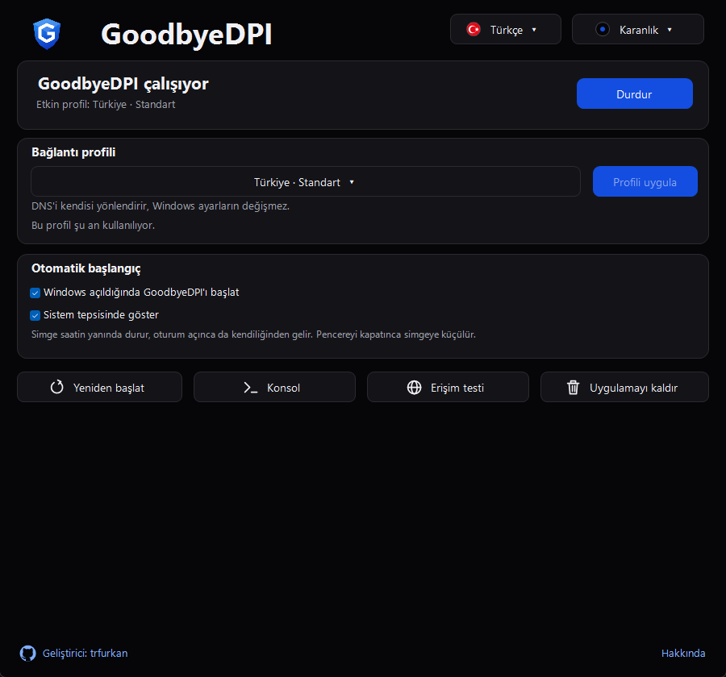
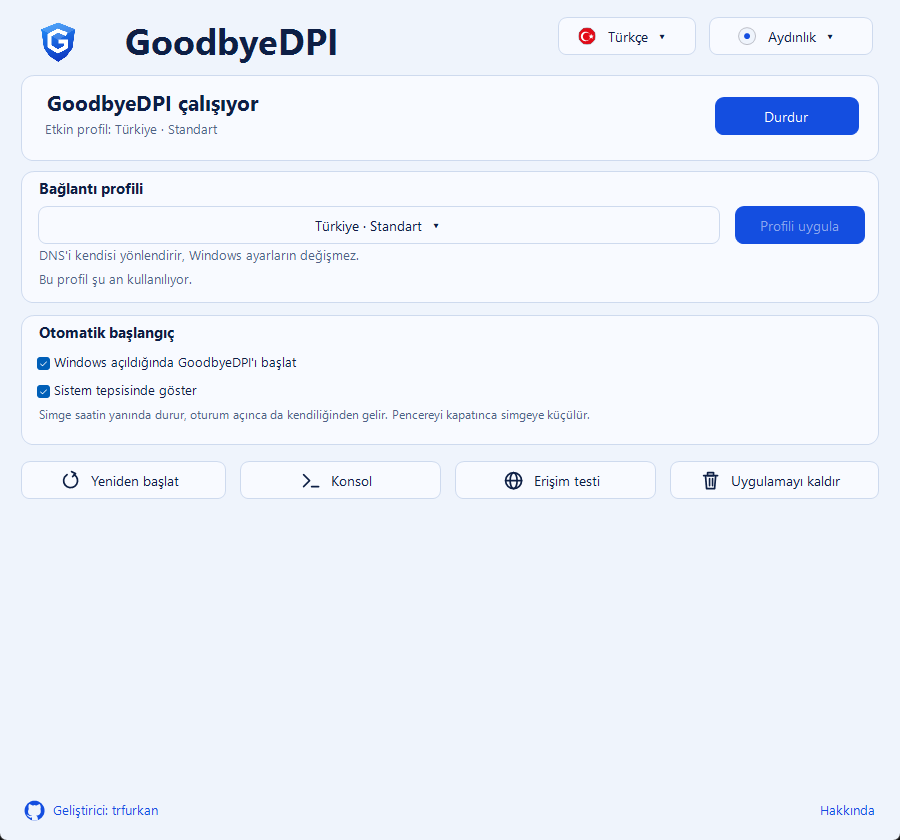
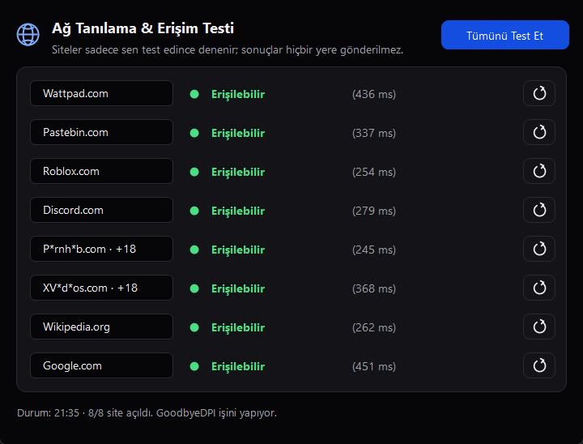

# GoodbyeDPI Tray

[GoodbyeDPI](https://github.com/ValdikSS/GoodbyeDPI)'ı komut satırıyla uğraşmadan kullanmanızı sağlayan, Windows ile birlikte otomatik açılıp sistem tepsisinde çalışan küçük bir uygulama.

  
  

## GoodbyeDPI Tray Ne işe yarar?

Türkiye’de erişimi engellenen Discord ve yasaklı sitelere VPN kullanmadan girmeni sağlar.

- **VPN değildir:** Trafiğin başka bir sunucuya yönlendirilmez, IP adresin değişmez. Bu yüzden VPN'lerdeki gibi hız kaybı ya da ping artışı olmaz.
- **Sadece engeli aşar:** İnternet sağlayıcının DPI ve DNS engellerini atlatır; diğer bağlantıların olduğu gibi çalışır.

Doğrudan IP adresiyle engellenen siteleri açamaz..

## İndir ve kur

[Releases](https://github.com/trfurkan/GoodbyeDPI-Tray/releases/latest) sayfasından **GoodbyeDPI-Installer**'ı indirip kurabilirsiniz. Kurulumdan sonra yeni sürüm çıkınca uygulama sana haber verir.

Windows 10/11 ve .NET Framework 4.8 gerekir.

## Özellikler

- Tek pencereden başlat, durdur, yeniden başlat. Yönetici izni istemez.
- Windows açılınca otomatik başlama ve sistem tepsisinde bekleme.
- GoodbyeDPI-Turkey'deki yedi profil.
- **Erişim testi:** Engelli ve normal birkaç siteyi deneyip GoodbyeDPI'ın işe yarayıp yaramadığını gösterir.
- Türkçe, İngilizce ve Rusça arayüz.
- Yedi tema: Aydınlık, Karanlık, Okyanus, Sakura, Güneş Batımı, Android ve Şampanya. İstersen Windows'a uyar.

Ayrıntılar için [kullanım rehberine](docs/KULLANIM.md) bakabilirsin.

## Teşekkürler
 Çalışmanın ana kaynak kodu: [GoodbyeDPI-Turkey](https://github.com/cagritaskn/GoodbyeDPI-Turkey) (cagritaskn)
[GoodbyeDPI](https://github.com/ValdikSS/GoodbyeDPI) (ValdikSS) ·
