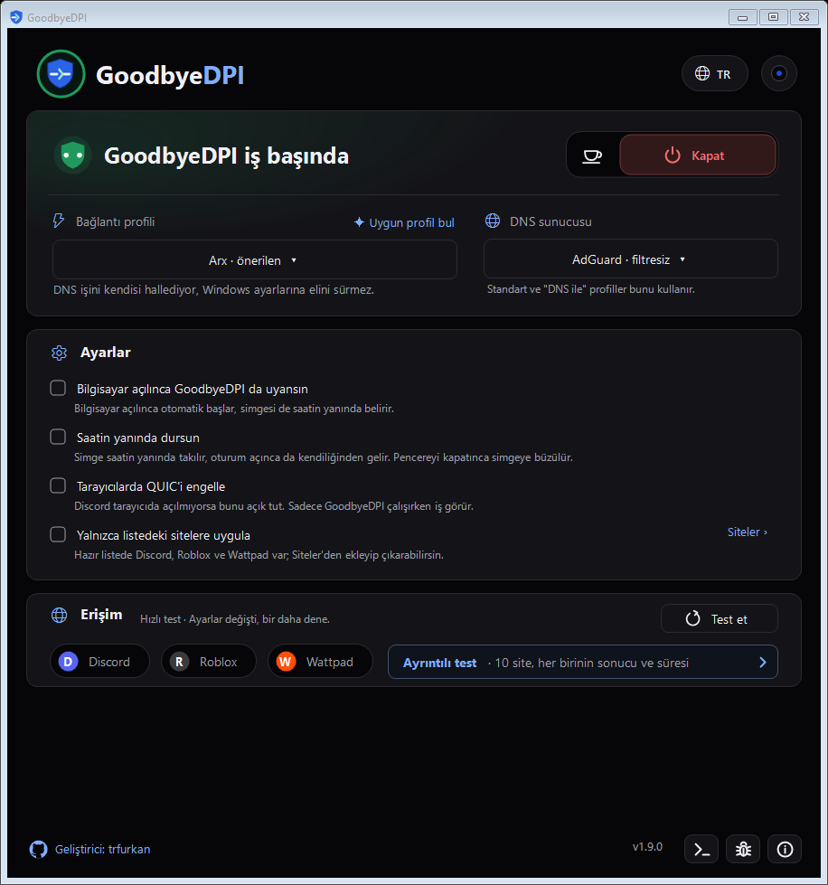

[Türkçe](README.md) · [English](README.en.md)

# GoodbyeDPI Tray

**GoodbyeDPI için Windows arayüzü ve hizmet yöneticisi.**

[](https://github.com/trfurkan/GoodbyeDPI-Tray/releases/latest)
[](https://github.com/trfurkan/GoodbyeDPI-Tray/releases)
[](LICENSE)


GoodbyeDPI Tray, [GoodbyeDPI](https://github.com/ValdikSS/GoodbyeDPI) motorunu ve [GoodbyeDPI-Turkey](https://github.com/cagritaskn/GoodbyeDPI-Turkey) profillerini tek pencereden yönetmeni sağlar. Bağlantıyı başlatma, DNS seçimi, site listesi ve erişim testlerini günlük kullanım için bir araya getirir.

**[Son sürümü indir](https://github.com/trfurkan/GoodbyeDPI-Tray/releases/latest)** · [Web sitesi](https://trfurkan.github.io/GoodbyeDPI-Tray/) · [Kullanım rehberi](docs/KULLANIM.md) · [Sürüm notları](https://github.com/trfurkan/GoodbyeDPI-Tray/releases)



> [!NOTE]
> Bu bir VPN değildir. IP adresini değiştirmez ve VPN’in gizlilik özelliklerini sağlamaz. Erişim sonucu internet sağlayıcına, uygulanan engele ve seçili profile bağlıdır; her ağda çalışması garanti edilmez.

## Kurulum ve ilk kullanım

**Gereksinimler:** Windows 10 veya 11 (x86/x64), .NET Framework 4.8.

1. [Son sürümden](https://github.com/trfurkan/GoodbyeDPI-Tray/releases/latest) `GoodbyeDPI-Installer-<sürüm>.exe` dosyasını indir.
2. Kurucuyu aç, kurulum notunu oku ve **Kur** düğmesine bas. Windows’un yönetici izni isteğini onayla.
3. Uygulamayı açıp önerilen **Arx** profiliyle başlat.
4. **Erişim testi** ile bağlantını kontrol et. Sonuç alamazsan **Uygun profil bul** ile diğer seçenekleri karşılaştır.

İmzasız veya az indirilen dosyalarda Windows ve tarayıcı uyarıları görülebilir. Uyarının ayrıntısını ve dosyanın bu deponun Releases sayfasından geldiğini kontrol et; uyarı tek başına güvenli ya da zararlı olduğu anlamına gelmez.

Mevcut bir GoodbyeDPI hizmeti bulunursa kurucu, hizmeti devralmak için onay ister. Kaldırmak için uygulamanın kaldırma seçeneğini veya **Windows Ayarlar → Uygulamalar** bölümünü kullanabilirsin.

## Özellikler

| Özellik | Ne sağlar? |
| --- | --- |
| **Bağlantı yönetimi** | Başlatma, durdurma ve süreli mola; ana pencereden veya tepsi simgesinden kontrol. |
| **Profil seçimi** | Arx, Nyx, Kitsune ve Raijin seçenekleri; yedi GoodbyeDPI profilini karşılaştırma. |
| **DNS seçimi** | AdGuard, Quad9, OpenDNS, CleanBrowsing ve Yandex. Varsayılan seçenek AdGuard filtresizdir. |
| **Reklam filtreleme** | AdGuard’ın reklam filtreleyen DNS seçeneği. DNS kullanmayan profillerde uygulanmaz; tüm reklamları engellemez. |
| **Site listesi** | Hazır Discord, Roblox ve Wattpad alan adlarına kendi adreslerini ekleme; müdahaleyi listedeki sitelerle sınırlama. |
| **Erişim testi** | Hızlı ve ayrıntılı bağlantı kontrolleri; yanıt sürelerini karşılaştırma. |
| **Konsol ve sorun bildirimi** | Motor çıktısını izleme ve göndermeden önce düzenlenebilen GitHub sorun taslağı hazırlama. |
| **Görünüm ve başlangıç** | Tema seçenekleri, Türkçe/İngilizce/Rusça arayüz ve Windows ile otomatik başlangıç. |

DNS seçimi yalnızca DNS yönlendirmesi kullanan profillerde etkilidir. Site listesi **alan adına** göre çalışır; uygulama adına göre seçim yapmaz. DNS ve QUIC engelleme ayarları site listesiyle sınırlanmaz.

## Nasıl çalışır?

GoodbyeDPI, trafik incelemesine dayanan bazı erişim engellerini aşmak için bağlantı verilerinin iletilme biçimini değiştirir. Engeli aşmaya çalışan motor GoodbyeDPI’dır; Tray, bu motorun kurulumunu ve günlük kullanımını kolaylaştırır.

- **Windows hizmeti:** `GoodbyeDPI` hizmeti SYSTEM yetkisiyle çalışır ve motor sürecini yönetir.
- **Masaüstü arayüzü:** Normal kullanıcı yetkisiyle çalışır; başlatma, durdurma ve ayar isteklerini hizmete iletir.
- **Bağlantı:** Trafik bir VPN sunucusuna yönlendirilmez. Doğrudan IP engelleri gibi bazı engelleme yöntemleri aşılamaz.
- **Güncellemeler:** Yeni sürüm bilgisi GitHub üzerinden alınır. Güncelleme denetimi ile kurulum ayrı işlemlerdir.

Bu proje, GoodbyeDPI ve GoodbyeDPI-Turkey’den bağımsızdır; bu projelerin resmî dağıtımı değildir.

## Sorun giderme

Bir site açılmıyorsa önce uygulamayı durdurup bağlantıyı karşılaştır. Ardından erişim testini çalıştır ve gerekirse farklı bir profil veya DNS seçeneğini dene. Başarısız test tek başına engel kanıtı değildir; site, DNS veya zaman aşımı kaynaklı olabilir.

Liste modu açıksa ulaşmaya çalıştığın alan adının listede olduğundan emin ol. Sorun devam ederse [hata bildirimi aç](https://github.com/trfurkan/GoodbyeDPI-Tray/issues/new) ve şunları ekle:

- Uygulama ve Windows sürümü.
- Seçili profil, DNS ve ilgili bağlantı ayarları.
- Sorunu tekrar oluşturmak için izlediğin adımlar ve beklediğin sonuç.
- Varsa ilgili günlük bölümü veya ekran görüntüsü; paylaşmadan önce kişisel bilgileri çıkar.

Uygulama günlüğü: `%LOCALAPPDATA%\GoodbyeDPI Tray\Logs\application.log`. Daha fazla bilgi için [kullanım rehberine](docs/KULLANIM.md) bakabilirsin.

## Geliştirme

Proje C#, WinForms ve .NET Framework 4.8 kullanır. Derleme betiği .NET Framework derleyicisini (`csc.exe`) çağırır; Visual Studio gerekmez. Komutları Windows’ta, depo kökünde çalıştır:

```powershell
powershell -NoProfile -ExecutionPolicy Bypass -File scripts\build.ps1
```

| Çıktı | İçerik |
| --- | --- |
| `build\app\GoodbyeDPI.Tray.exe` | Arayüz, hizmet ve kaldırıcı |
| `dist\GoodbyeDPI-Installer.exe` | Kurulum dosyası |

Derlemenin ardından temel doğrulama:

```powershell
powershell -NoProfile -ExecutionPolicy Bypass -File tests\verify.ps1
```

Diğer test betikleri `tests/` altında bulunur. `tests/system/` betikleri gerçek kurulumu ve Windows hizmetini değiştirir; bunları yalnızca bu amaçla ayrılmış bir test ortamında çalıştır.

```text
src/                 Uygulama, hizmet, kurulum ve arayüz kodu
assets/              Uygulama simgeleri ve görsel kaynaklar
scripts/             Derleme ve paketleme betikleri
tests/               Doğrulama ve davranış testleri
vendor/goodbyedpi/    Motor, sürücüler ve üçüncü taraf lisansları
docs/                Web sitesi, kullanım rehberi ve sürüm notları
```

## Katkı

Hata bildirimleri, kullanım geri bildirimleri ve pull request’ler kabul edilir. Kapsamlı bir değişiklik düşünüyorsan önce [issue açarak](https://github.com/trfurkan/GoodbyeDPI-Tray/issues) yaklaşımını paylaş. Pull request’inde değişikliğin amacını ve yaptığın kontrolleri belirt.

Projeyi [Furkan](https://github.com/trfurkan) geliştiriyor. İşine yarıyorsa GitHub’da yıldız vererek destek olabilirsin.

## Lisans ve kaynak projeler

Uygulama kodu [Apache License 2.0](LICENSE) ile yayımlanır. Üçüncü taraf bileşenlerin lisansları ayrıdır; ayrıntılar [THIRD_PARTY_NOTICES.md](THIRD_PARTY_NOTICES.md) dosyasındadır.

- [GoodbyeDPI](https://github.com/ValdikSS/GoodbyeDPI) — ValdikSS, bağlantı motoru.
- [GoodbyeDPI-Turkey](https://github.com/cagritaskn/GoodbyeDPI-Turkey) — cagritaskn, Türkiye profilleri ve temel dağıtım.
- [WinDivert](https://github.com/basil00/WinDivert) — basil00, ağ paketi yakalama ve yönlendirme.
