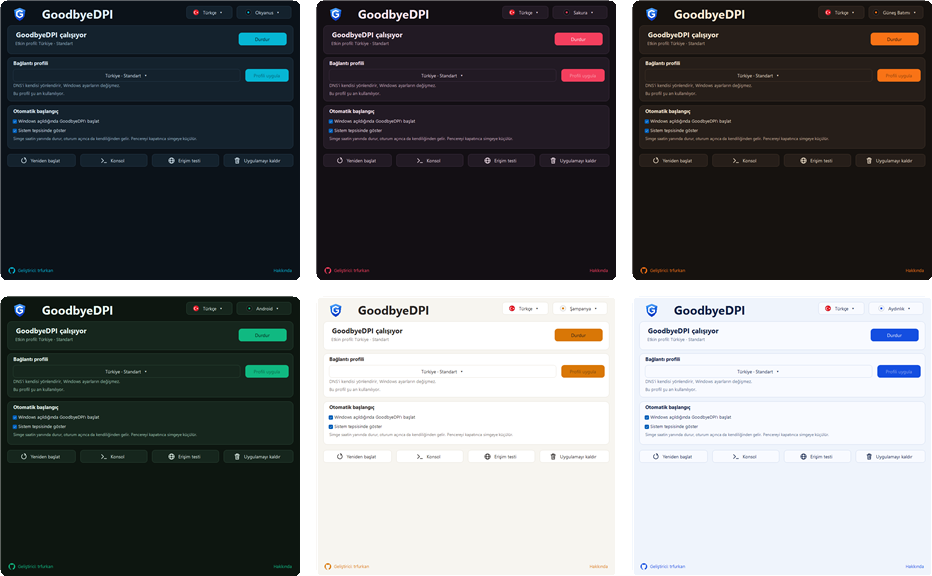
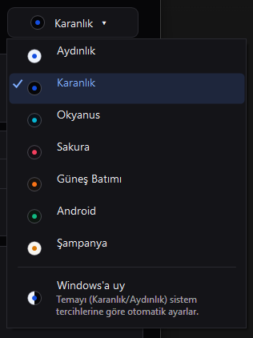
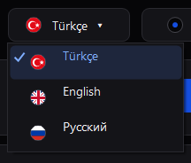
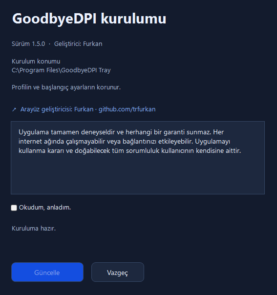

  

<h1 align="center">GoodbyeDPI Tray</h1>

  <b>GoodbyeDPI'ı tek tıkla kullan.</b> 
  Discord ve erişimi engellenen sitelere VPN kullanmadan girmeni sağlayan Windows uygulaması. 
  Komut satırı yok, CMD dosyası yok; Windows açılınca kendiliğinden çalışır.

  
  
  
  

  <a href="https://github.com/trfurkan/GoodbyeDPI-Tray/releases/latest"><b>⬇️ Ücretsiz indir</b></a>
  &nbsp;·&nbsp;
  <a href="https://trfurkan.github.io/GoodbyeDPI-Tray/">Tanıtım sayfası</a>
  &nbsp;·&nbsp;
  <a href="docs/KULLANIM.md">Kullanım rehberi</a>

  
  

## Ne işe yarar?

Türkiye'de internet sağlayıcıları bazı siteleri DPI ve DNS üzerinden engelliyor. GoodbyeDPI bu engelleri bilgisayarının içinde atlatır; GoodbyeDPI Tray de onu kolayca yönetmeni sağlar.

- **VPN değildir:** Trafiğin başka bir sunucuya yönlendirilmez, IP adresin değişmez. Bu yüzden VPN'lerdeki gibi hız kaybı ya da ping artışı olmaz.
- **Sadece engeli aşar:** İnternet sağlayıcının DPI ve DNS engellerini atlatır; diğer bağlantıların olduğu gibi çalışır.
- **Sınırı var:** Doğrudan IP adresiyle engellenen siteleri açamaz. Bunu Erişim testinde görebilirsin.

## Özellikler

| Özellik | Ne yapar? |
| --- | --- |
| **Tek tıkla başlat** | Başlat, durdur, profil değiştir; yönetici izni istemez. Saatin yanındaki simgeden de yapabilirsin. |
| **Windows'la açılır** | Bilgisayar açılınca GoodbyeDPI da çalışır. İstersen kapatabilirsin. |
| **Yedi Türkiye profili** | GoodbyeDPI-Turkey'deki profillerin hepsi. Biri çalışmazsa diğerine tek tıkla geç. |
| **Erişim testi** | Engelli ve normal siteleri gerçek bağlantıyla dener, hangisinin açıldığını gösterir. |
| **Yedi tema** | Aydınlık, Karanlık, Okyanus, Sakura, Güneş Batımı, Android ve Şampanya. İstersen Windows'a uyar. |
| **Üç dil** | Türkçe, İngilizce ve Rusça. Dili tema düğmesinin yanındaki bayraktan değiştirirsin. |

## Temalar ve diller

  

  
  &nbsp;&nbsp;
  

## İşe yarıyor mu? Hemen gör

Erişim testi Discord, Roblox, Wattpad gibi engelli sitelere ve Google gibi normal sitelere gerçek bir HTTPS bağlantısı açar. Engelliler açılmıyorsa başka bir profil denemeni, hiçbiri açılmıyorsa bağlantını kontrol etmeni söyler.

  

## Kurulum

Tek dosya, bir dakika sürer. Windows 10/11 ve .NET Framework 4.8 gerekir; Windows'ta genelde zaten yüklüdür.

1. [Releases](https://github.com/trfurkan/GoodbyeDPI-Tray/releases/latest) sayfasından **GoodbyeDPI-Installer**'ı indir ve aç. Windows SmartScreen uyarı verirse **Ek bilgi → Yine de çalıştır**'a bas.
2. Notu okuyup onay kutusunu işaretle ve **Kur**'a bas. Windows'un izin penceresini onayla.
3. Uygulamayı aç ve **Başlat**'a bas. Gerisini uygulama halleder.
4. **Erişim testini** çalıştır. Siteler açılmıyorsa başka bir profil seç.

  

## Sık sorulanlar

<b>GoodbyeDPI Tray bir VPN mi?</b>

Hayır. Trafiğin başka bir sunucuya gitmez ve IP adresin değişmez. Uygulama yalnızca internet sağlayıcının DPI ve DNS engellerini atlatır, bu yüzden VPN'lerdeki gibi hız kaybı ya da ping artışı olmaz.

<b>Discord'a girmek için işe yarar mı?</b>

Discord'un engeli DPI ve DNS üzerinden uygulandığı için çoğu internet sağlayıcısında işe yarar. Hangi profilin çalışacağı sağlayıcıya göre değişir; uygulamadaki Erişim testi bunu görmeni kolaylaştırır.

<b>Hangi profili seçmeliyim?</b>

Önce **Türkiye · Standart**'ı dene. Bazı siteler açılmazsa ya da yavaşsa alternatiflere geç. Alternatif 2 ve 4 genelde yavaşlık sorununu çözer.

<b>Windows neden uyarı veriyor?</b>

Kurulum dosyası dijital olarak imzalı olmadığı için Windows SmartScreen uyarı verebilir. **Ek bilgi → Yine de çalıştır** ile devam edebilirsin. Uygulamanın tüm kaynak kodu bu depoda açık.

<b>Chrome, Edge ya da Firefox indirirken neden uyarıyor?</b>

Tarayıcılar imzasız ve az indirilmiş dosyalar için "yaygın olarak indirilmiyor" ya da "zararlı olabilir" gibi uyarılar gösterir. Bu, dosyada bir sorun bulduklarını değil, dosyayı henüz tanımadıklarını gösterir. Chrome ve Edge'de indirilenler listesinde dosyanın yanındaki menüden **Sakla**'yı, Firefox'ta **İzin ver ve indir**'i seçebilirsin. Kurucuyu her zaman yalnızca bu depodaki Releases sayfasından ya da tanıtım sayfasından indir.

<b>Uygulama güvenilir mi?</b>

Uygulamanın tüm kaynak kodu bu depoda açık; isteyen inceleyebilir ya da kendisi derleyebilir. Hiçbir kişisel bilgi toplamaz, internete yalnızca günde bir kez GitHub'a son sürümü sormak için bağlanır, bunu da Hakkında penceresinden kapatabilirsin. Bazı antivirüs programları, GoodbyeDPI'ın kullandığı ağ sürücüsü WinDivert yüzünden uyarı verebilir; bu sürücü ağ trafiğini değiştirebildiği için bu tür programlarda sık görülen bir yanlış alarmdır. Uygulama deneyseldir, kullanma kararı sana aittir.

<b>Daha önce GoodbyeDPI-Turkey kurduysam ne olur?</b>

Kurucu eski GoodbyeDPI hizmetini bulur ve devralmak için onay ister. Onaylarsan seçtiğin profil korunur, eski klasörü sonra silebilirsin.

<b>Nasıl kaldırırım?</b>

Uygulamadaki **Uygulamayı kaldır** düğmesine bas ya da Windows Ayarlar > Uygulamalar'dan kaldır. Uygulama ayarları ve günlükleriyle birlikte tamamen silinir.

Daha fazlası için [kullanım rehberine](docs/KULLANIM.md) bakabilirsin. Bir sorun görürsen [GitHub'da bildir](https://github.com/trfurkan/GoodbyeDPI-Tray/issues).

## Hakkımda

  <a href="https://github.com/trfurkan">
    <picture>
      <source media="(prefers-color-scheme: dark)" srcset="docs/images/github-mark-white.svg">
      
    </picture>
  </a>
  &nbsp;
  

Merhaba, ben Furkan. Boş vakitlerimde hobi olarak hayatı kolaylaştıran, sade ve kullanıcı dostu projeler geliştiriyorum. Profesyonel bir iddiam yok; ürettiğim çözümler işinize yaradıysa ne mutlu bana. İlginiz ve desteğiniz için teşekkürler!

  <a href="https://github.com/trfurkan/GoodbyeDPI-Tray/issues/new"><b>🐞 Hata bildir ya da öneride bulun</b></a>
  &nbsp;·&nbsp;
  <a href="https://github.com/trfurkan/GoodbyeDPI-Tray"><b>⭐ GitHub'da yıldız vererek destek ol</b></a>

## Bilmen gerekenler

> Uygulama tamamen deneyseldir ve herhangi bir garanti sunmaz. Her internet ağında çalışmayabilir veya bağlantını etkileyebilir. Uygulamayı kullanma kararı ve doğabilecek tüm sorumluluk kullanıcının kendisine aittir. GoodbyeDPI Tray bağımsız bir projedir; ValdikSS/GoodbyeDPI ya da cagritaskn/GoodbyeDPI-Turkey'in resmî sürümü değildir.

## Teşekkürler

Çalışmanın ana kaynak kodu: [GoodbyeDPI-Turkey](https://github.com/cagritaskn/GoodbyeDPI-Turkey) (cagritaskn) · [GoodbyeDPI](https://github.com/ValdikSS/GoodbyeDPI) (ValdikSS)

Lisans: [Apache 2.0 lisansı](LICENSE) · [Üçüncü taraf bildirimleri](THIRD_PARTY_NOTICES.md)
