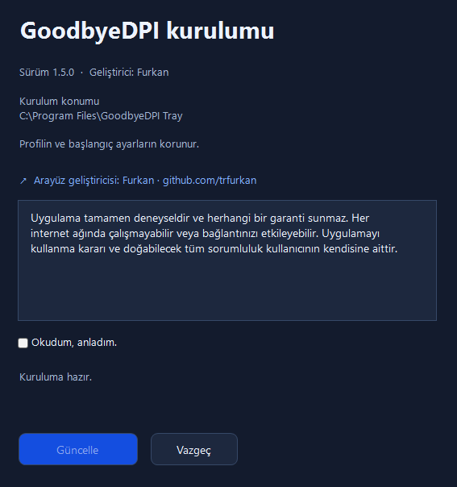
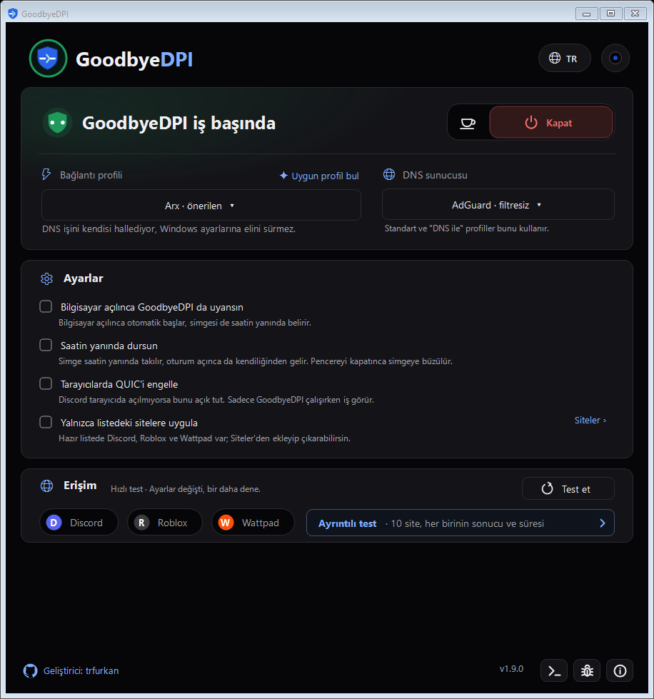
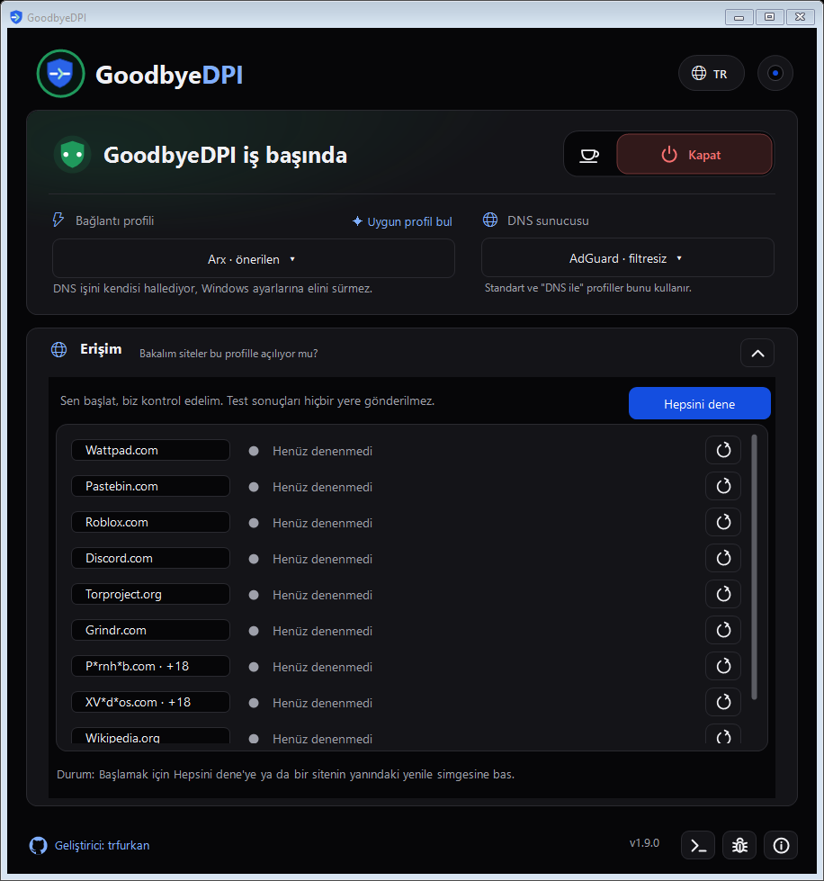

# GoodbyeDPI Tray — Kullanım rehberi

[Projeye dön](../README.md) · [Son sürümü indir](https://github.com/trfurkan/GoodbyeDPI-Tray/releases/latest) · [Web sitesi](https://trfurkan.github.io/GoodbyeDPI-Tray/)

Bu rehber standart GoodbyeDPI sürümünün kurulumunu, bağlantı ayarlarını ve sorun giderme adımlarını anlatır. Ekranların görünümü kullandığın sürüme ve temaya göre değişebilir.

## 1. Kurulum ve ilk bağlantı

**Gereksinimler:** Windows 10 veya 11, .NET Framework 4.8.

1. [Releases](https://github.com/trfurkan/GoodbyeDPI-Tray/releases/latest) sayfasından `GoodbyeDPI-Installer-<sürüm>.exe` dosyasını indir.
2. Kurucuyu aç, kurulum notunu oku ve onay kutusunu işaretle.
3. **Kur** düğmesine bas ve Windows’un yönetici izni isteğini onayla. Mevcut kurulumda düğme **Güncelle** olarak görünebilir.
4. Uygulamayı aç, **Arx · önerilen** profilini seç ve **Başlat** düğmesine bas.
5. **Erişim testi** ile sonucu kontrol et.

Windows veya tarayıcı bir uyarı gösterirse ayrıntısını oku ve dosyanın bu projenin Releases sayfasından geldiğini doğrula. Kaynağından emin olmadığın bir dosyayla devam etme.

Varsayılan kurulum klasörü `C:\Program Files\GoodbyeDPI Tray` konumudur. İlk kurulumda **Değiştir** ile başka bir klasör seçebilirsin. Güncelleme mevcut kurulum konumunu kullanır.

Önceden kurulmuş bir GoodbyeDPI hizmeti bulunursa kurucu devralmak için onay ister. Yeni kurulumun çalıştığını kontrol etmeden eski klasörünü silme.

## 2. Başlatma, durdurma ve mola

| Kontrol | Ne yapar? |
| --- | --- |
| **Başlat** | GoodbyeDPI’ı seçili ayarlarla çalıştırır. |
| **Durdur** | GoodbyeDPI motorunu durdurur. |
| **Mola ver** | Motoru 5 veya 15 dakika durdurur; süre sonunda yeniden çalıştırır. |
| **Devam et** | Molayı beklemeden bitirip motoru çalıştırır. |
| **Molayı yönet** | Mola seçeneklerini açar; molayı iptal edip motoru kapalı bırakabilirsin. |

**Çalışıyor** durumu motorun açık olduğunu gösterir; tüm sitelerin açıldığı anlamına gelmez.

Mola süresini Windows hizmeti takip eder. Pencereyi kapatmak molayı iptal etmez. Bilgisayarı yeniden başlatırsan mola korunmaz; Windows ile başlatma tercihin geçerli olur. Profil değiştirmek molayı bitirebilir; profil bulucu mola sırasında kullanılamaz.

## 3. Profil seçimi

**Bağlantı → Profil** listesinden bir seçenek seç. Profil hemen uygulanır; ayrıca bir uygulama düğmesine basman gerekmez. Motor çalışıyorsa yeni ayarlarla yeniden başlar ve bağlantıda kısa bir kesinti olabilir.

| Profil | DNS yönlendirmesi | Temel GoodbyeDPI ayarı |
| --- | --- | --- |
| **Arx · önerilen** | Var | Mod 5, TTL 5 |
| **Nyx · DNS’siz** | Yok | TTL 3 |
| **Kitsune · DNS’siz** | Yok | Mod 5 |
| **Nyx · DNS ile** | Var | TTL 3 |
| **Kitsune · DNS ile** | Var | Mod 5 |
| **Raijin · DNS ile** | Var | Mod 9 |
| **Raijin · DNS’siz** | Yok | Mod 9 |

Önce **Arx** ile başla. Sonuç alamazsan diğer profilleri karşılaştır. Profil isimleri bir güç veya hız sıralaması değildir; hangi ayarın işe yaradığı bağlantına göre değişir.

### Uygun profil bul

**Uygun profil bul**, yedi profili sırayla deneyerek erişim sonuçlarını karşılaştırır. Test öncesindeki açıklamayı oku; profil geçişlerinde bağlantın kısa sürelerle kesilebilir.

Test bittiğinde veya iptal edildiğinde önceki profil ve açık/kapalı durumu geri yüklenir. Sonuçları inceleyip önerilen profili kabul edersen seçimin uygulanır. Bir testte iyi sonuç alınması diğer sitelere erişim garantisi değildir.

## 4. DNS seçimi ve reklam filtreleme

**Bağlantı → DNS sunucusu** listesinden seçim yap. Seçimin hemen kaydedilir; çalışan motor yeni ayarı uygularken kısa bir geçiş yaşanabilir.

- **AdGuard · filtresiz:** Varsayılan seçenek.
- **AdGuard · reklamsız:** DNS üzerinden reklam filtreleme seçeneği. Tüm reklamları engellemez.
- **Quad9 · güvenli**, **OpenDNS**, **CleanBrowsing · güvenli** ve **Yandex:** Diğer DNS seçenekleri.

DNS yönlendirmesi kullanan bir profil seçtiğinde bu tercih uygulanır; uygulama Windows’un DNS ayarlarını değiştirmez.

**DNS’siz** bir profil seçersen DNS listesi pasifleşir. Kaydettiğin seçim silinmez, ancak o profil tarafından kullanılmaz. Böyle bir durumda sisteminin veya kullandığın uygulamanın DNS ayarları önem kazanır.

## 5. Yalnızca seçtiğin sitelerde çalıştırma

Ayarlar bölümündeki yalnızca listedeki sitelere uygulama seçeneğini aç. Yanındaki **Siteleri düzenle** düğmesinden hazır alan adlarını görebilir ve kendi adreslerini ekleyebilirsin.

1. Liste düzenleyicisini aç.
2. Eklemek istediğin site adresini yaz; örneğin `example.com`.
3. Ekleme işlemini tamamla. Sonradan eklediğin adresleri aynı pencereden kaldırabilirsin.
4. Bağlantını yeniden test et.

Hazır listede Discord, Roblox ve Wattpad’in kullandığı alan adları bulunur. Bir sitenin resimleri veya başka içerikleri farklı alan adlarından yüklenebilir; gerekli adresleri ayrıca eklemen gerekebilir.

> [!NOTE]
> Seçim **alan adına** göre yapılır; uygulama adına veya `.exe` dosyasına göre seçim değildir. DNS yönlendirmesi ve QUIC engelleme ayarı bu site listesiyle sınırlanmaz.

## 6. Tarayıcılarda QUIC’i engelleme

Discord gibi bir hizmet masaüstü uygulamasında açılıp tarayıcıda açılmıyorsa **Tarayıcılarda QUIC’i engelle** ayarını deneyebilirsin.

Bu seçenek, GoodbyeDPI çalışırken Windows Güvenlik Duvarı üzerinden dışarı giden UDP 443 trafiğini engeller. Destekleyen uygulamalar TCP bağlantısına dönebilir. Kural yalnızca tarayıcıya veya site listesine özel değildir; aynı trafiği kullanan başka uygulamaları da etkileyebilir.

Motor durduğunda, molaya girdiğinde veya uygulama kaldırıldığında kural kaldırılır. Sorun yaşarsan ayarı kapatıp bağlantıyı karşılaştır.

## 7. Erişim testini okuma

Hızlı test Discord, Roblox ve Wattpad bağlantılarını kontrol eder. Ayrıntılı test daha fazla site için HTTPS bağlantı sonucunu ve geçen süreyi gösterir.

- **Başarılı sonuç:** Test sırasında ilgili adrese bağlantı kurulabildi.
- **Başarısız sonuç:** Engelleme, DNS, zaman aşımı veya sitenin kendisi nedeniyle olabilir.
- **Yanıt süresi:** Test bağlantısının ne kadar sürdüğünü gösterir; indirme hızı ölçümü değildir.

Tarayıcı ve uygulamadaki test farklı sonuç verebilir. Tarayıcının kendi DNS veya bağlantı ayarları bulunabilir. Profil, DNS veya site listesi değişikliğinden sonra testi yeniden çalıştır.

## 8. Tepsi, başlangıç ve görünüm

- **Windows açıldığında GoodbyeDPI’ı başlat:** Otomatik başlangıcı yönetir.
- **Sistem tepsisinde göster:** Saatin yanındaki simgenin görünürlüğünü yönetir.
- **Tema seçimi:** Açık, koyu ve renkli temaları veya Windows’un görünümünü takip eden seçeneği kullanabilirsin.
- **Dil seçimi:** Türkçe, İngilizce veya Rusça seçebilirsin.

Tepsi simgesine sağ tıklayarak bağlantı kontrollerine ulaşabilirsin. Pencereyi kapatmak, hizmet olarak çalışan GoodbyeDPI’ı durdurmaz. Bağlantıya müdahaleyi bitirmek için **Durdur** düğmesini kullan.

Klavyeyle gezinmek için **Tab**, düğmeleri kullanmak için **Enter/Boşluk**, listelerde seçim yapmak için ok tuşlarını kullanabilirsin.

## 9. Güncellemeler

Uygulama yeni sürüm bilgisi için GitHub’ı kontrol eder ve güncelleme bulunduğunda haber verir. **Hakkında** bölümünden elle kontrol yapabilir veya otomatik denetimi kapatabilirsin.

**Neler değişti?** sürüm notlarını gösterir. **Yeni sürümü indir** güncelleme indirme akışını başlatır. İndirme ve kurulum sırasında ekrandaki yönlendirmeleri izle. Alternatif olarak [Releases](https://github.com/trfurkan/GoodbyeDPI-Tray/releases/latest) üzerinden kurucuyu indirip mevcut kurulumunu güncelleyebilirsin.

Güncelleme kontrolü, uygulamanın kendini sormadan kurması anlamına gelmez. Sürüm notları yayımlandıkları dilde gösterilir.

## 10. Sorun giderme

| Sorun | Deneyebileceğin adım |
| --- | --- |
| Hiçbir site açılmıyor | GoodbyeDPI’ı durdurup normal bağlantını kontrol et. Genel siteler de açılmıyorsa ağ bağlantını incele. |
| Yalnızca belirli siteler açılmıyor | Site listesini kontrol et, başka profil veya DNS seçeneğiyle yeniden test et. |
| Site açılıyor, resimler yüklenmiyor | Farklı DNS dene; liste modu açıksa içerik sunucularının alan adlarını kontrol et. |
| Uygulama açılıyor, tarayıcı açmıyor | QUIC engelleme seçeneğini dene; tarayıcının DNS ayarlarını da kontrol et. |
| DNS listesi pasif | DNS’siz profil seçilidir. DNS yönlendiren bir profile geç. |
| Bağlantı yavaşladı veya başka uygulama etkilendi | Motoru durdurup karşılaştır; ardından profil ve QUIC ayarını ayrı ayrı dene. |

Konsoldan motor çıktısını inceleyebilir veya uygulamanın sorun bildirimi seçeneğiyle GitHub taslağı hazırlayabilirsin. Göndermeden önce raporu kontrol et ve kişisel bilgileri çıkar.

Uygulama günlüğü: `%LOCALAPPDATA%\GoodbyeDPI Tray\Logs\application.log`.

[Hata bildirimi açarken](https://github.com/trfurkan/GoodbyeDPI-Tray/issues/new) uygulama sürümünü, Windows sürümünü, profil/DNS seçimini ve sorunu tekrar oluşturma adımlarını paylaş.

## 11. Kaldırma ve sınırlar

**Hakkında → Uygulamayı kaldır** veya **Windows Ayarlar → Uygulamalar** üzerinden kaldırıcıyı aç. Windows’un yönetici izni isteğini onayla ve işlemin tamamlanmasını bekle.

GoodbyeDPI Tray bir VPN değildir; IP adresini değiştirmez ve bağlantını gizlemez. Doğrudan IP engellerini aşamaz ve her ağda çalışması garanti edilmez.

Asıl bağlantı motoru [GoodbyeDPI](https://github.com/ValdikSS/GoodbyeDPI), temel Türkiye profilleri [GoodbyeDPI-Turkey](https://github.com/cagritaskn/GoodbyeDPI-Turkey) projesinden gelir. Tray bu araçların kullanımını kolaylaştıran bağımsız bir arayüzdür. Lisans ayrıntıları için [üçüncü taraf bildirimlerine](../THIRD_PARTY_NOTICES.md) bakabilirsin.
